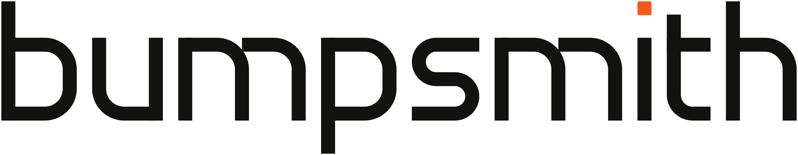
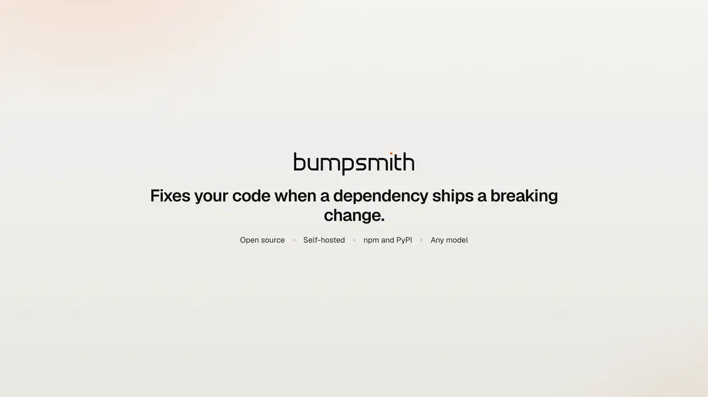
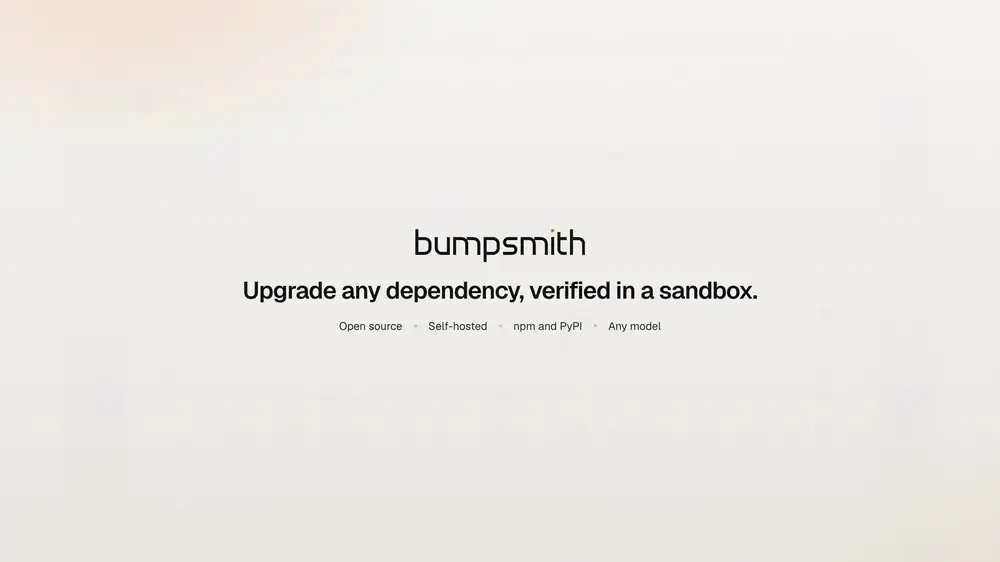
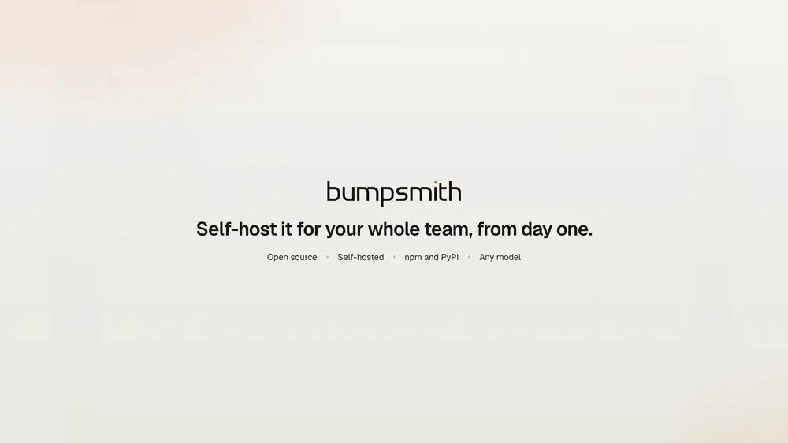
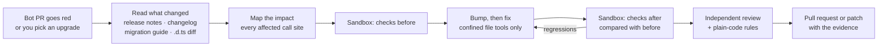

<div align="center">

<picture>
  <source media="(prefers-color-scheme: dark)" srcset="dashboard/brand/wordmark-dark.svg">
  
</picture>

### Fixes your code when a dependency ships a breaking change.

Dependabot and Renovate open the pull request. Bumpsmith makes it green:<br>
it reads the changelog, fixes your code in a sandbox, proves it with your own tests, and shows its work.

[](https://github.com/bumpsmith/bumpsmith/actions/workflows/ci.yml)
[](LICENSE)
[](package.json)
[](#supported)
[](CONTRIBUTING.md)

[**Quick start**](#quick-start) · [**MCP & skill**](docs/mcp.md) · [**How it works**](#how-it-works) · [**Benchmarks**](#benchmarks) · [**Self-hosting**](docs/self-hosting.md) · [**Security**](#how-it-stays-safe)

<a href="docs/media/hero.mp4">
  <picture>
    <source media="(prefers-color-scheme: dark)" srcset="docs/media/hero-dark.webp">
    
  </picture>
</a>

<sub>A real upgrade from the benchmark, no cuts: <code>node-fetch</code> 2 → 3 went ESM-only and dropped <code>timeout</code>. Bumpsmith wrote the wrapper, mapped the option, ran the tests, and its reviewer flagged the one thing tests couldn't prove. <a href="docs/media/hero.mp4">Watch the MP4</a>.</sub>

</div>

---

## Why

Keeping dependencies current is easy until a **major** version lands. The bot opens a pull
request, CI goes red, and someone has to read three changelogs, find every call site, and
fix them. That PR sits for weeks; meanwhile you fall further behind on security fixes.

Bumpsmith does that someone's job, and it is built to be trusted with it:

- **It proves the fix.** Your install, build, typecheck, lint and tests run in an isolated
  container before and after the upgrade. No passing check, no "ready".
- **It shows its sources.** Every breaking change it acts on is quoted word for word from the
  release notes, the migration guide or the type definitions, with a link.
- **It gets a second opinion.** A separate reviewer and plain-code safety rules check the diff
  before anything is written, and say what they could not verify.
- **A human always merges.** Bumpsmith opens a pull request or stages a patch. It never pushes
  to your default branch.

## Quick start

### GitHub Action: rescue red bot PRs automatically

```sh
npx bumpsmith init     # writes .github/workflows/bumpsmith.yml (wired to your CI) and .bumpsmith.yml
```

Add your model key as a repository secret. When CI fails on a Dependabot or Renovate pull
request, Bumpsmith opens a companion PR with the same upgrade plus the code changes, links the
two, and comments on the bot PR. If it can't produce a verified fix, it says why and lists the
affected code instead. Full example: [`examples/bumpsmith.yml`](examples/bumpsmith.yml).

### CLI: on your machine

Needs Node 22.13+ and Docker.

```sh
npx bumpsmith scan                     # which dependencies are a major (or more) behind; no AI
npx bumpsmith explain zod@4.1.0        # what breaks and where your code is affected
npx bumpsmith fix zod@4.1.0            # upgrade + fix + verify; writes a patch and evidence
npx bumpsmith fix zod@4.1.0 --apply    # ...and stage the patch if it was verified
npx bumpsmith rescue --github owner/repo --provider claude-code   # fix red bot PRs as PRs
```

### Dashboard: review, apply, and run upgrades live

```sh
npx bumpsmith dashboard                # http://127.0.0.1:4477
```

The first start prints a one-time link that creates the owner account. Everything Bumpsmith did
is there:

- each upgrade's pipeline and the breaking changes it read;
- the diff, with the agent's edits marked;
- your checks before and after, and the independent review.

**Apply patch** stages a verified result in one click.

<div align="center">

<br><sub><kbd>⌘</kbd> <kbd>K</kbd> to jump anywhere or start an upgrade, with the model and spend cap you choose.</sub>
</div>

### Self-hosted, for your team

```sh
cd deploy && echo "BUMPSMITH_DOMAIN=bumpsmith.acme.dev" > .env
openssl rand -base64 32 > master.key && docker compose up -d
```

The same app runs as a multi-user server behind HTTPS. It's built for security reviews from
day one:

| Area    | What you get                                                               |
| ------- | -------------------------------------------------------------------------- |
| Sign-in | SSO (OIDC and SAML) with group-to-role mapping; two-factor authentication. |
| Access  | Custom roles and an access matrix for each repository.                     |
| Data    | Encrypted secrets and a tamper-evident audit log.                          |
| Setup   | Onboarding in the browser.                                                 |

Read the [self-hosting guide](docs/self-hosting.md). The [security controls](docs/security/controls.md)
page maps every control to SOC 2, ISO 27001, NIST 800-63B and OWASP ASVS.

<div align="center">

</div>

### From your AI agent: MCP server and skill

Give Claude Code, Codex, Cursor, VS Code or any MCP client the tools to upgrade dependencies with proof. They can:

- check whether a release is safe to adopt;
- explain what breaks;
- run a verified upgrade;
- read the evidence and apply the result.

```text
/plugin marketplace add bumpsmith/bumpsmith      # Claude Code: MCP server + skill
/plugin install bumpsmith@bumpsmith
```

```sh
claude mcp add bumpsmith -- npx -y bumpsmith@latest mcp     # or: codex mcp add bumpsmith -- npx -y bumpsmith@latest mcp
```

[Install in Cursor](cursor://anysphere.cursor-deeplink/mcp/install?name=bumpsmith&config=eyJjb21tYW5kIjoibnB4IiwiYXJncyI6WyIteSIsImJ1bXBzbWl0aEBsYXRlc3QiLCJtY3AiXX0=) · [Install in VS Code](https://vscode.dev/redirect/mcp/install?name=bumpsmith&config=%7B%22command%22%3A%22npx%22%2C%22args%22%3A%5B%22-y%22%2C%22bumpsmith%40latest%22%2C%22mcp%22%5D%7D) · [Skill file](skills/bumpsmith/SKILL.md) · [All clients, tools, and HTTP access for teams](docs/mcp.md)

A self-hosted Bumpsmith also serves MCP at `/mcp` for your applications, with personal API tokens.
The access matrix and the audit log apply there too.

## How it works



1. **Read.** Release notes, changelogs, migration guides and the type definitions of both
   versions become a list of breaking changes. Each one is backed by a verbatim quote.
2. **Map.** Every place your code touches a changed API, found with AST search.
3. **Fix.** The upgrade is installed and the code edited in an isolated container. The model
   gets only file tools confined to the repository, and the named check commands.
4. **Verify.** Your own checks run before and after. Failures that existed before the upgrade
   are not counted against it; new ones send the agent back for another round.
5. **Review.** A separate model reviews the diff against the evidence. Rules written in plain
   code block new network or process calls, new dependencies, weakened tests and protected
   paths.
6. **Hand over.** A pull request (or patch) states:
   - what changed upstream;
   - what changed in your code, and why;
   - which checks pass before and after;
   - what could not be verified.

## Benchmarks

Measured on real upgrades that broke something and that a human later fixed in a merged
pull request. Bumpsmith replays each one from the commit before the human's fix.

On a **held-out set** of 24 upgrades from repositories never used in development:

| Metric                      | Result                                                |
| --------------------------- | ----------------------------------------------------- |
| Verified fixes              | **12 of 22** it could run (55%), 4 at high confidence |
| Correctly refused           | 1 (the target release is a known malicious package)   |
| Safety-rule false positives | 0                                                     |
| Model cost                  | **$0.73** per verified fix (API list price)           |
| Median time                 | 3.3 minutes                                           |

On 42 real repositories of 13 shapes (npm, pnpm, Yarn, Bun, workspaces, pip, Poetry, uv,
Pipenv and others), Bumpsmith sets up 38 and verifies 32 with no crashes; the rest say why.
Methods, caveats and raw data: [bench/RESULTS.md](bench/RESULTS.md) and [bench/ZOO.md](bench/ZOO.md).

## How it compares

|                                       | Dependabot / Renovate | AI coding agents |              **Bumpsmith**               |
| ------------------------------------- | :-------------------: | :--------------: | :--------------------------------------: |
| Opens upgrade PRs                     |           ✓           |        —         |            ✓ (rescues theirs)            |
| Fixes code a breaking change broke    |           —           |        ✓         |                    ✓                     |
| Reads the changelog and quotes it     |           —           |    sometimes     |       ✓ every change, with sources       |
| Runs your tests before **and** after  |           —           |    sometimes     |         ✓ in an isolated sandbox         |
| Independent review of the diff        |           —           |        —         |         ✓ plus plain-code rules          |
| Refuses malicious or too-new releases |        partly         |        —         | ✓ OSV check and a 3-day release-age gate |
| No network for the code it runs       |           —           |        —         |    ✓ only a read-only registry mirror    |
| Runs in your CI, with your model key  |           ✓           |      varies      |                    ✓                     |

## How it stays safe

Bumpsmith runs code it didn't write (your dependencies' install and test steps) and lets a model
edit your repository, so it treats both as hostile.

- **Isolated execution.** Each run is a container with:
  - no credentials, and no environment passed in from the host;
  - limits on CPU, memory, processes and time;
  - no network, except during installs, when the only reachable server is a read-only registry
    mirror. It allows only `GET`/`HEAD` to npm and PyPI.
- **Supply-chain caution.**
  - New versions are used only after a 3-day release-age wait.
  - Install scripts are off.
  - Versions on the OSV malicious-package list are refused.
- **Limited AI.** The agent has no shell, so it can't edit CI workflows, secrets or
  infrastructure. Secrets found in files are masked before anything reaches the model.
- **Strict publishing.** The publishing step re-checks the reviewed patch's hash and the rules,
  and rebuilds every file from your default branch with a no-fuzz patch.
- **Respect for your repository.** Bumpsmith never:
  - overwrites a commit a human pushed;
  - reopens a PR you closed;
  - force-pushes your branches.

  It labels its PRs `ai-generated`, with the model named.

Found a hole? Please report it privately: [SECURITY.md](SECURITY.md).

## Supported

|                   |                                                                                                                                                                                  |
| ----------------- | -------------------------------------------------------------------------------------------------------------------------------------------------------------------------------- |
| **Ecosystems**    | npm (npm, pnpm, Yarn 1–4, Bun, workspaces) · PyPI (pip, uv, Poetry, PEP 621)                                                                                                     |
| **Models**        | Anthropic, OpenAI, Gemini, OpenRouter, Groq, Together, DeepSeek, or any OpenAI-compatible endpoint. On your own machine you can also use your Claude Code or Codex subscription. |
| **CI**            | GitHub Actions (Linux runners with Docker)                                                                                                                                       |
| **Test services** | Postgres, MySQL, MariaDB, Redis, Valkey and Mongo, started from your workflow's `services:`                                                                                      |

<details>
<summary><b>Configuration</b> (<code>.bumpsmith.yml</code>, optional)</summary>

```yaml
version: 1
ecosystems: [npm, pypi]
release_age_days: 3 # can be raised, not lowered
limits:
  open_pull_requests: 3
ignore:
  - package: react
    versions: ["19.x"]
checks: # optional; detected automatically
  test: "pnpm test"
pull_requests:
  labels: [dependencies, bumpsmith]
  draft_below: medium # open as draft below this confidence
rules:
  protected_paths: ["infra/**"]
```

Config is read only from your default branch. It can tighten Bumpsmith's rules but never loosen
them. Commands are plain argv (no shell operators).
</details>

<details>
<summary><b>Tokens for the GitHub Action</b></summary>

Pull requests opened with the default `GITHUB_TOKEN` [don't trigger your CI](https://docs.github.com/en/actions/concepts/security/github_token).
Create a small GitHub App for your organisation:

- **Permissions:** Contents and Pull requests (write), and Checks (read).
- **Install** it on the repository.
- **Secrets:** set the `BUMPSMITH_APP_ID` variable and the `BUMPSMITH_APP_PRIVATE_KEY` secret.

The example workflow then uses [`actions/create-github-app-token`](https://github.com/actions/create-github-app-token).
</details>

## FAQ

<details>
<summary><b>Does my code leave my machine or CI?</b></summary>

Only to the model provider you configure, and only what the agent reads. Secrets found in files
are masked first. The dashboard has no analytics or other telemetry, and its fonts are bundled.
</details>

<details>
<summary><b>What does it cost?</b></summary>

On the held-out benchmark, $0.73 of model usage per verified fix at API list prices.

You set a spend cap per run. On your own machine you can use your Claude Code or Codex
subscription instead of an API key.
</details>

<details>
<summary><b>How is this different from asking a coding agent to do the upgrade?</b></summary>

An agent edits code. Bumpsmith adds three things around it:

- **Evidence:** it reads the release notes and quotes them.
- **Proof:** your checks run before and after, in a sandbox with no network.
- **A gate:** an independent review plus rules that decide whether the result reaches you.

When it can't prove a fix, it says so instead of guessing.
</details>

<details>
<summary><b>What happens when it can't fix something?</b></summary>

You get a "needs a human" result, with:

- the breaking changes;
- every affected call site;
- what it tried;
- why it stopped (for example, the tests already failed before the upgrade, or a package
  needs a system library).
</details>

## Limitations

- **Grouped bot PRs:** they are handled as one job. The biggest major jump is analysed in depth
  and the other packages are upgraded with it.
- **Private registries and git dependencies:** not supported in the sandbox yet.
- **The GitHub Action:** needs Linux runners with Docker.

## Contributing

Bug reports, repositories that trip it up, and pull requests are all welcome. See
[CONTRIBUTING.md](CONTRIBUTING.md).

```sh
pnpm install && pnpm check     # typecheck, lint, unit and Action tests
pnpm test:docker               # sandbox isolation and exfiltration tests
pnpm bumpsmith dashboard       # the dashboard, from source
```

The videos in this README are recorded from the real dashboard by
[`scripts/demo`](scripts/demo). Re-record them after a UI change.

## License

[Apache-2.0](LICENSE). Bumpsmith is free to self-host. A hosted version for teams is on the way.
